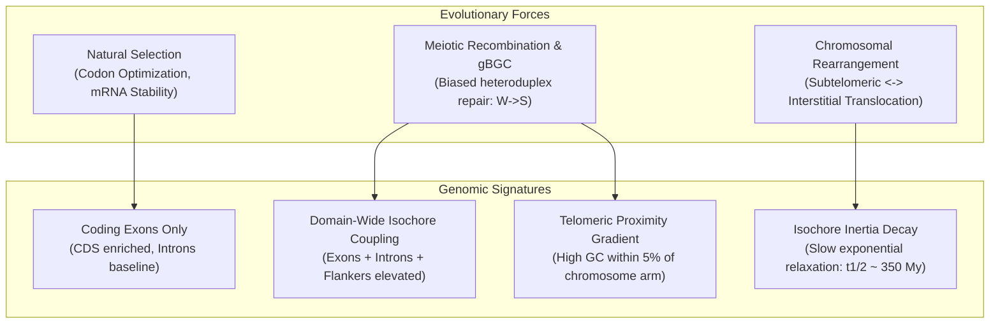

# Chapter 1: Scientific Aims & Evolutionary Framework

## 1. Executive Summary & Problem Statement

Hemoglobin is the canonical model system of molecular evolution. In jawed vertebrates (Gnathostomata), functional hemoglobin is an $\alpha_2\beta_2$ heterotetramer composed of two $\alpha$-globin and two $\beta$-globin polypeptide subunits, each coordinating an oxygen-binding heme group.

Despite the fact that $\alpha$- and $\beta$-globin genes originated from a single ancestral gene via tandem duplication and subsequent chromosomal translocation ~450–500 million years ago, their base composition (GC content) exhibits dramatic, puzzling divergence across modern vertebrate genomes:

1. **Mammalian Canonical Divergence**: In placental mammals (*Homo sapiens*, *Equus caballus*, *Bos taurus*, *Puma concolor*, *Rattus norvegicus*), $\alpha$-globin clusters reside in extremely GC-rich isochores ($\text{GC} > 60\%–68\%$, $Z > +2.5\sigma$), while $\beta$-globin clusters reside in AT-rich or baseline isochores ($\text{GC} \approx 40\%–44\%$, $Z \approx -0.5\sigma$ to $0.0\sigma$).
2. **Avian Polarity Inversion**: In birds (*Gallus gallus*, *Anas platyrhynchos*, *Aquila chrysaetos*, *Sturnus vulgaris*), this relationship is inverted: $\beta$-globin loci exhibit higher GC content and codon GC3 than $\alpha$-globin loci ($\text{mean } \beta = +0.96\sigma \text{ vs. } \alpha = +0.74\sigma$).
3. **Squamate Extreme Hyper-gBGC**: In lacertid lizards (*Podarcis muralis*, *Zootoca vivipara*), both $\alpha$ and $\beta$ clusters reach extraordinary GC elevations ($Z > +5.0\sigma$ to $+5.9\sigma$), representing the most extreme GC outliers in the vertebrate kingdom.
4. **Giant Urodela Intron Dilution**: In giant salamanders and newts (*Ambystoma mexicanum*, *Triturus cristatus*; genomes 24–28 Gb), intronic gigantism dilutes locus whole-gene GC completely down to neutral genomic baselines ($Z \approx 0$).
5. **Ancestral Cyclostome Neutrality**: In jawless vertebrates (*Eptatretus burgeri*, *Lampetra fluviatilis*, *Petromyzon marinus*), ancestral proto-globin loci reside in unbiased, neutral isochores ($Z \approx 0$).

---

## 2. Research Aims

This project investigates the macroevolutionary forces driving intra-genomic and cross-species base composition divergence at vertebrate globin loci. Specifically, our primary aims are:

- **Aim 1: Universal Taxonomic Mapping**: Construct a high-resolution, standardized comparative atlas of globin genomic loci across all major vertebrate clades (44 species spanning Cyclostomata to Eutheria).
- **Aim 2: Statistical Baseline Contextualization**: Eliminate compositional biases by standardizing locus metrics against empirical whole-genome protein-coding and isochore distributions using standardized $Z$-scores.
- **Aim 3: Disentangling Evolutionary Mechanisms**: Discriminate between three competing hypotheses:
  - **Hypothesis A (Adaptive / Functional Selection)**: GC elevation is driven by natural selection favoring mRNA thermodynamic stability, GC-rich codon translation efficiency, or metabolic adaptation.
  - **Hypothesis B (GC-Biased Gene Conversion / gBGC)**: GC elevation is a neutral, non-adaptive consequence of meiotic double-strand break repair gradients, which concentrate disproportionately near chromosome telomeres.
  - **Hypothesis C (Isochore Inertia)**: Loci translocated from subtelomeric regions into interstitial regions retain elevated GC content for hundreds of millions of years due to extraordinarily slow neutral decay rates ($t_{1/2} \approx 350\text{ My}$).
- **Aim 4: Reproducible Bioinformatics Engine**: Deliver an installable, extensible Python package capable of automatically discovering and curating globin clusters from any newly sequenced vertebrate genome.

---

## 3. Theoretical Framework: Selection vs. gBGC vs. Inertia

### 3.1 Selection vs. gBGC Predictions
If **natural selection** on protein or transcript function were the primary driver:
- GC elevation should be strictly confined to coding exons and degenerate codon positions (GC3).
- Non-coding introns and intergenic spaces should mirror genome-wide neutral baselines.
- Flanking syntenic non-globin genes should show zero correlation with globin GC.

If **GC-biased gene conversion (gBGC)** is the primary driver:
- GC elevation must be domain-wide, affecting coding exons, non-coding introns, and syntenic flanking genes alike.
- Locus GC must correlate strongly with physical and relative distance to chromosome telomeres, where meiotic crossover rates peak in vertebrates.

### 3.2 The Isochore Inertia Mechanism
When globin loci are translocated from subtelomeric regions to interstitial chromosome positions (as occurred during mammalian karyotype evolution):
- The locus escapes the active subtelomeric recombination gradient ($r \to r_{\text{interstitial}}$).
- Neutral substitution dynamics take over:
  $$\frac{d(\text{GC})}{dt} = u - (u + v)\text{GC}$$
- With vertebrate neutral mutation rates ($u \approx 1.2 \times 10^{-9}, v \approx 2.4 \times 10^{-9}$ substitutions/site/year), the relaxation half-life is:
  $$t_{1/2} = \frac{\ln 2}{u + v} \approx 350 \times 10^6 \text{ years}$$
- Consequently, interstitial globin loci (such as human $\beta$-globin on chromosome 11p or rodent syntenic blocks) exhibit "fossilized" GC characteristics reflecting their ancestral chromosomal locations.
