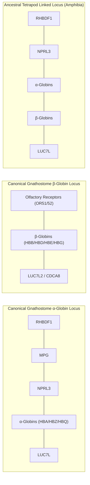

# Chapter 2: Locus Identification & Curation Strategy

## 1. Overview of the Curation Strategy

Identifying homologous globin loci across 44 divergent vertebrate taxa spanning ~500 million years of evolutionary time presents formidable bioinformatics challenges:
- Globin genes undergo frequent lineage-specific tandem duplications, gene conversions, and pseudogenization.
- Karyotypic reshuffling, whole-genome duplications (3R in teleost fish), and chromosomal translocations frequently disrupt collinearity.
- Genome annotation quality varies between RefSeq releases, Ensembl versions, and chromosome-scale versus scaffold assemblies.

To establish rigorous, unambiguous locus boundaries, we employ a **Syntenic Anchor Framework** anchored on ultra-conserved flanking orthologs rather than relying solely on globin sequence similarity.

---

## 2. Syntenic Anchor Framework

### 2.1 The Canonical $\alpha$-Globin Syntenic Block
Across jawed vertebrates, the $\alpha$-globin cluster is ancestrally embedded within an ancient gene synteny group that predates the tetrapod divergence:
- **Upstream Flankers**:
  - `RHBDF1` (*rhomboid 5 homolog 1*): Transmembrane serine protease homolog.
  - `MPG` (*N-methylpurine DNA glycosylase*): DNA base excision repair enzyme.
  - `NPRL3` (*NPR3-like, GATOR1 complex subunit*): Highly conserved amino acid-sensing regulator of mTORC1. In human, mouse, and other amniotes, the major erythroid-specific locus control elements (e.g. *MCS-R1* through *MCS-R4*) reside directly within the introns of *NPRL3*.
- **Downstream Flankers**:
  - `LUC7L` (*LUC7-like spliceosome factor*): Marks the distal boundary of the canonical $\alpha$ locus.
  - `SNRNP25` (*small nuclear ribonucleoprotein U11/U12 subunit 25*).

### 2.2 The Canonical $\beta$-Globin Syntenic Block
In amniotes (mammals, birds, reptiles), the $\beta$-globin locus originated from a translocation event that detached $\beta$ from the ancestral linked cluster:
- **Upstream Flanker**:
  - Extensive clusters of **Olfactory Receptor genes** (`OR51` and `OR52` family arrays).
- **Downstream Flankers**:
  - `LUC7L2` (*LUC7-like 2*): Paralagous to *LUC7L*, situated adjacent to the modern $\beta$ locus.
  - `CDCA8` (*cell division cycle associated 8 / Borealin*).
  - `IMPG2` (*interphotoreceptor matrix proteoglycan 2*).

---

## 3. Clade-Specific Curation Paradigms

### 3.1 Jawless Vertebrates (Cyclostomata: Hagfishes & Lampreys)
- **Evolutionary Context**: Cyclostomes represent the living sister group to all jawed vertebrates, having diverged prior to or at the earliest stages of vertebrate whole-genome duplications (1R/2R). They possess monomeric or homooligomeric **proto-globins** that have not undergone subfunctionalization into distinct $\alpha$ and $\beta$ chains.
- **Synteny Anchor**: In *Eptatretus burgeri* (Inshore Hagfish) and *Lampetra fluviatilis* (European River Lamprey), the proto-globin tandem arrays are directly linked to `NPRL3` and `UBE2I` (*ubiquitin conjugating enzyme E2 I*), proving that the **NPRL3 linkage represents the primary ancestral state of the vertebrate globin superfamily**.

### 3.2 Non-Teleost Ray-Finned Fishes (Holostei: Spotted Gar)
- **Evolutionary Context**: *Lepisosteus oculatus* diverged before the teleost-specific 3R whole-genome duplication.
- **Synteny Anchor**: Gar maintains an unduplicated, linked cluster on linkage group 13 (`LG13: 14.65–14.90 Mb`), flanked continuously by *rhbdf1a*, *mpg*, *nprl3*, linked $\alpha+\beta$ globins, and *luc7l*.

### 3.3 Teleost Fish (Post-3R Whole-Genome Duplication)
- **Evolutionary Context**: Teleost fishes experienced a lineage-specific whole-genome duplication (3R / WGD), duplicating the ancestral cluster into two paralogous loci:
  - **Locus A (Major Cluster)**: Flanked by *rhbdf1a* and *kank2* (e.g. Zebrafish Chr 3; Minnow Chr 3). Contains adult $\alpha$ and $\beta$ pairs.
  - **Locus B (Minor Cluster)**: Flanked by *rhbdf1b* and *lcmt1* (e.g. Zebrafish Chr 12; Minnow Chr 17). Contains embryonic $\alpha$ and $\beta$ pairs.

### 3.4 Amphibians: Gymnophiona & Giant Urodela
- **Gymnophiona (Caecilians)**: *Geotrypetes*, *Rhinatrema*, and *Microcaecilia* retain intact ancestral linked clusters (*RHBDF1*—*MPG*—*NPRL3*—$\alpha$—$\beta$—*LUC7L*), with a secondary translocated adult $\beta$-globin locus on a separate chromosome.
- **Giant Urodela (Axolotl & Crested Newt)**: Possess massive 24–28 Gb genomes. In *Ambystoma mexicanum* and *Triturus cristatus*, the ancestral linked cluster spans 5–8 Mb due to gigantic intronic expansions of up to 450 kb per gene, but maintains strict collinearity with *RHBDF1*, *NPRL3*, and flanking syntenic markers.

---

## 4. Quality Control & Filtering Protocols

1. **Strict Protein-Coding CDS Filtering**:
   - In RefSeq GFF annotations, non-coding RNA features (5S rRNAs, tRNAs, snoRNAs, etc.) lack CDS entries.
   - The pipeline filters strictly for features with valid coding sequences (`cds_length > 0`), preventing false clustering around repetitive non-coding RNA clusters (e.g., the 32,000 non-coding RNA features in fathead minnow).
2. **Exclusion of Stray Pseudogenes**:
   - Only annotated protein-coding genes and validated globin pseudogenes within the syntenic interval are included.
   - Solitary, disabled globin retrotransposed fragments located elsewhere in the genome are excluded.
3. **Flanking Window Margins**:
   - A standardized padding of 25 kb to 50 kb is applied to outermost gene models to capture upstream and downstream regulatory domains and syntenic non-globin controls.
