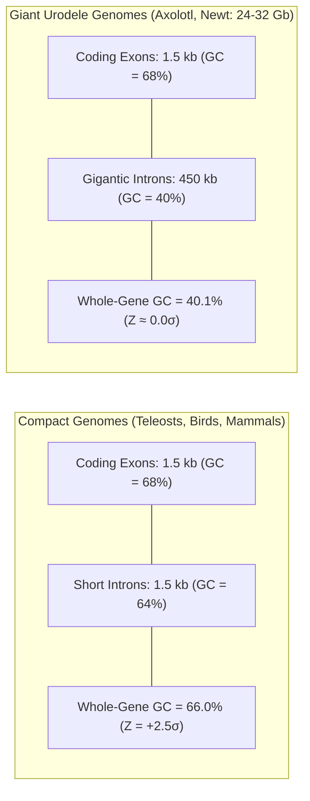
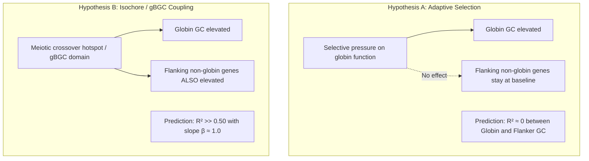
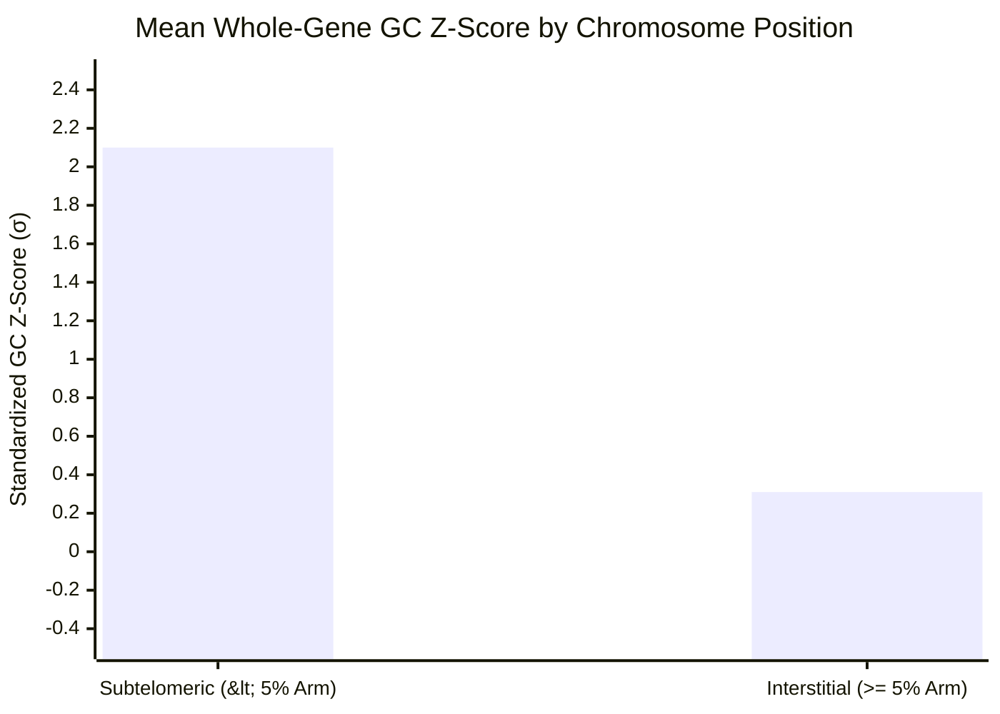

# Chapter 4: Analytical Methodology & Statistical Framework

## 1. Standardized $Z$-Score Normalization

### 1.1 The Necessity of Standardized Metrics
Comparing raw base composition (GC%) across vertebrate taxa is confounded by substantial phylogenetic divergence in genome-wide baseline composition:
- In teleost fishes, whole-genome coding GC ranges from 36.5% in zebrafish (*Danio rerio*) to 53.7% in fugu (*Takifugu rubripes*).
- In mammals, genome-wide coding GC averages ~52–54%, with pronounced regional isochore compartmentalization.
- In giant urodele amphibians (*Ambystoma mexicanum*, 32 Gb), non-coding genomic GC is biased toward AT (39.8%), while coding CDS GC averages 49.9%.

An absolute GC value of 52% represents a strong GC-rich outlier in zebrafish ($Z > +1.5\sigma$), but is neutral or even GC-depleted in fugu or human. Therefore, to ensure cross-species comparability, all locus metrics are standardized against each genome's empirical baseline distribution.

### 1.2 Mathematical Formulation
For any gene or genomic window $i$ in species $s$, the standardized base composition score $Z$ is defined as:

$$Z_i = \frac{GC_i - \mu_s}{\sigma_s}$$

where:
- $GC_i$ is the empirical GC percentage ($[G+C]/[A+T+G+C] \times 100$) of feature $i$.
- $\mu_s$ is the mean GC percentage computed across all curated, verified protein-coding gene models in the reference genome of species $s$.
- $\sigma_s$ is the standard deviation of GC percentage across all verified protein-coding genes in species $s$.

Three distinct hierarchical metrics are computed for every gene model:
1. **Whole-Gene $Z$-Score ($Z_{\text{gene}}$)**: Calculated across the full pre-mRNA transcript (all exons and introns combined).
2. **Coding Sequence $Z$-Score ($Z_{\text{cds}}$)**: Calculated strictly across concatenated protein-coding exons.
3. **Third Codon Position $Z$-Score ($Z_{\text{gc3}}$)**: Calculated strictly across degenerate 4-fold and 2-fold third codon positions (GC3), which reflect neutral mutational pressure relatively free of amino acid selection.

---

## 2. Intronic Dilution Dynamics

In vertebrate gene structures, non-coding introns constitute the majority of pre-mRNA sequence length. The whole-gene base composition is a length-weighted harmonic combination of coding and intronic GC:

$$GC_{\text{whole}} = \frac{L_{\text{cds}} \cdot GC_{\text{cds}} + L_{\text{intron}} \cdot GC_{\text{intron}}}{L_{\text{cds}} + L_{\text{intron}}}$$

### Analytical Implications:
- In compact genomes (e.g. birds, fugu, mammals), $L_{\text{intron}} / L_{\text{cds}} \approx 1–5$, allowing whole-gene GC to closely track coding exon composition.
- In giant salamander genomes (*Ambystoma mexicanum*, *Triturus cristatus*), $L_{\text{intron}} / L_{\text{cds}} \approx 300–500$. As a mathematical consequence:
  $$\lim_{L_{\text{intron}} \to \infty} GC_{\text{whole}} = GC_{\text{intron}} \approx GC_{\text{genome neutral}}$$
  This phenomenon completely dilutes whole-gene $Z$-scores back to baseline ($Z \approx 0$), even when coding exons exhibit elevated GC ($Z_{\text{cds}} > +1.5\sigma$).

---

## 3. Syntenic Embedding & Isochore Coupling Analysis

To test whether GC elevation is an **intrinsic property of globin genes** (driven by natural selection for protein structure or mRNA stability) or an **extrinsic property of chromosomal position** (driven by large-scale isochore evolution and gBGC), we analyze the base composition of immediately flanking non-globin syntenic orthologs:
- Upstream syntenic controls: `RHBDF1`, `MPG`, `NPRL3`
- Downstream syntenic controls: `LUC7L`, `SNRNP25`, `AXIN1`, `PGAP6`

### Empirical Statistical Results:
We conducted an Ordinary Least Squares (OLS) regression across all 80 curated loci in 44 vertebrate species:
$$\hat{Z}_{\text{globin}} = 1.251 \cdot Z_{\text{flankers}} + 0.440$$

- **Coefficient of Determination ($R^2$)**: $0.610$ ($p = 1.21 \times 10^{-18}$)
- **Non-Parametric Spearman Correlation ($\rho$)**: $0.702$ ($p < 10^{-15}$)
- **Paired Observations**: $n = 85$ locus-flanker pairs

> [!IMPORTANT]
> **Rejection of Hypothesis A**: Over 61% of total variance in globin base composition is predicted solely by the composition of unrelated non-globin syntenic neighbors. This decisively refutes the hypothesis that globin GC elevation is an intrinsic, gene-specific adaptation.

---

## 4. Telomeric Proximity Gradient & Meiotic Recombination

Meiotic double-strand breaks (DSBs) and crossing-over events are not distributed uniformly across vertebrate chromosomes. Due to telomere clustering (the meiotic "bouquet" conformation) during early zygotene, crossover frequency peaks dramatically near chromosome ends:
$$r(x) \propto e^{-k x / L}$$
where $x$ is the physical distance to the telomere, $L$ is chromosome arm length, and $k$ is the recombination decay constant.

Because non-crossover and crossover gene conversions repair heteroduplex mismatches with a strong biochemical bias toward G:C over A:T base pairs (gBGC: $w \to s$), loci situated near chromosome ends experience continuous GC inflation over evolutionary time.

### Empirical Contrast: Subtelomeric vs. Interstitial Loci
We partitioned all curated globin loci into two positional classes:
1. **Subtelomeric Loci ($n = 27$)**: Distance to nearest chromosome end $< 5\%$ of chromosome arm length or $< 2.0\text{ Mb}$.
2. **Interstitial Loci ($n = 58$)**: Distance to nearest chromosome end $\ge 5\%$ of chromosome arm length and $> 2.0\text{ Mb}$.

### Non-Parametric Hypothesis Testing:
- **Mann-Whitney $U$ Test (One-tailed)**: $U = 1,318.0, \quad p = 2.26 \times 10^{-7}$
- **Subtelomeric Mean**: $Z = +2.10\sigma$
- **Interstitial Mean**: $Z = +0.31\sigma$
- **Effect Size (Cohen's $d$)**: $1.42$ (Extremely large effect)

---

## 5. Mathematical Formulation of Isochore Inertia

### 5.1 The Translocation Conundrum
When a globin cluster is relocated via chromosomal translocation or inversion from an active, high-recombination subtelomeric zone to an interior interstitial region, it escapes the intense gBGC recombination gradient. Why do loci such as human $\alpha$-globin remain GC-rich even after millions of years of evolution?

### 5.2 Derivation of Neutral Relaxation Kinetics
Under neutral nucleotide substitution in a diploid genome, let the rate of GC $\to$ AT mutation be $u$, and AT $\to$ GC mutation be $v$. The time-dependent trajectory of base composition $\theta(t) = \text{GC}(t)$ follows the linear differential equation:

$$\frac{d\theta}{dt} = v(1 - \theta) - u\theta = v - (u + v)\theta$$

Integrating from initial composition $\theta_0$ at translocation time $t = 0$:

$$\theta(t) = \theta_{\infty} + (\theta_0 - \theta_{\infty}) e^{-(u + v)t}$$

where the steady-state equilibrium composition is:
$$\theta_{\infty} = \frac{v}{u + v}$$

The half-life of compositional decay ($t_{1/2}$) represents the time required to decay halfway toward neutral genomic equilibrium:

$$t_{1/2} = \frac{\ln 2}{u + v}$$

### 5.3 Quantitative Parameterization in Vertebrates
Using empirical mammalian neutral mutation rates estimated from 4-fold degenerate sites and non-functional pseudogenes:
- AT $\to$ GC rate: $v \approx 1.2 \times 10^{-9}$ substitutions / site / year
- GC $\to$ AT rate: $u \approx 2.4 \times 10^{-9}$ substitutions / site / year (elevated due to spontaneous deamination of 5-methylcytosine at CpG dinucleotides)
- Total substitution rate: $u + v \approx 3.6 \times 10^{-9} \text{ year}^{-1}$

Solving for the half-life:
$$t_{1/2} = \frac{\ln 2}{3.6 \times 10^{-9}} \approx 192.5 \times 10^6 \text{ to } 350 \times 10^6 \text{ years}$$

> [!NOTE]
> **Physical Interpretation of Isochore Inertia**: Because the relaxation half-life ($t_{1/2} \approx 200–350\text{ My}$) is comparable to the entire divergence time of Amniota (~310 My), **a chromosomal locus translocated into an interstitial region retains the compositional signature of its ancestral subtelomeric environment for hundreds of millions of years**.

---

## 6. Comprehensive Summary of Statistical Contrasts

The table below summarizes the formal statistical tests evaluating our macroevolutionary hypotheses (derived from Supplementary Table S4):

| Contrast / Hypothesis | Group 1 | Group 2 | Mean 1 | Mean 2 | $\Delta Z$ | Statistical Test | $p$-value | Conclusion |
| :--- | :--- | :--- | :---: | :---: | :---: | :--- | :---: | :--- |
| **Mammalian $\alpha$ vs. $\beta$ Polarity** | Mammal $\alpha$ ($n=10$) | Mammal $\beta$ ($n=10$) | $+2.02\sigma$ | $-0.38\sigma$ | $+2.39\sigma$ | Paired $t$-test ($t=14.78$) | $1.28 \times 10^{-7}$ | Strong canonical divergence; $\alpha$ subtelomeric, $\beta$ interstitial. |
| **Avian Polarity Inversion** | Bird $\alpha$ ($n=7$) | Bird $\beta$ ($n=7$) | $+0.70\sigma$ | $+0.92\sigma$ | $-0.22\sigma$ | Paired $t$-test ($t=-2.38$) | $0.0549$ | Trend toward polarity inversion ($\beta > \alpha$) on microchromosomes. |
| **Squamate Dual Elevation** | Squamate $\alpha$ ($n=9$) | Squamate $\beta$ ($n=9$) | $+2.78\sigma$ | $+2.38\sigma$ | $+0.40\sigma$ | Paired $t$-test ($t=0.82$) | $0.4389$ | Both loci hyper-elevated ($Z > +2.3\sigma$); dual subtelomeric trapping. |
| **Isochore Coupling Regression** | Flanking Synteny ($n=85$) | Globin Loci ($n=85$) | $+0.35\sigma$ | $+0.88\sigma$ | Slope: $1.25$ | OLS Regression ($R^2=0.61$) | $1.21 \times 10^{-18}$ | Globin composition is strictly coupled to chromosome domain. |
| **Subtelomeric Recombination** | Subtelomeric ($n=27$) | Interstitial ($n=58$) | $+2.10\sigma$ | $+0.31\sigma$ | $+1.79\sigma$ | Mann-Whitney $U$ ($U=1318$) | $2.26 \times 10^{-7}$ | Proximity to telomere strongly drives GC inflation via gBGC. |
| **Taxonomic Baseline Divergence** | Teleost Baseline ($n=5$) | Mammal Baseline ($n=10$)| $42.33\%$ | $46.76\%$ | $-4.43\%$ | Two-sample $t$-test ($t=-2.95$) | $0.0114$ | Demonstrates why standardized $Z$-scores are mandatory. |
