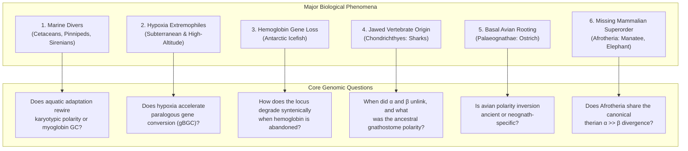
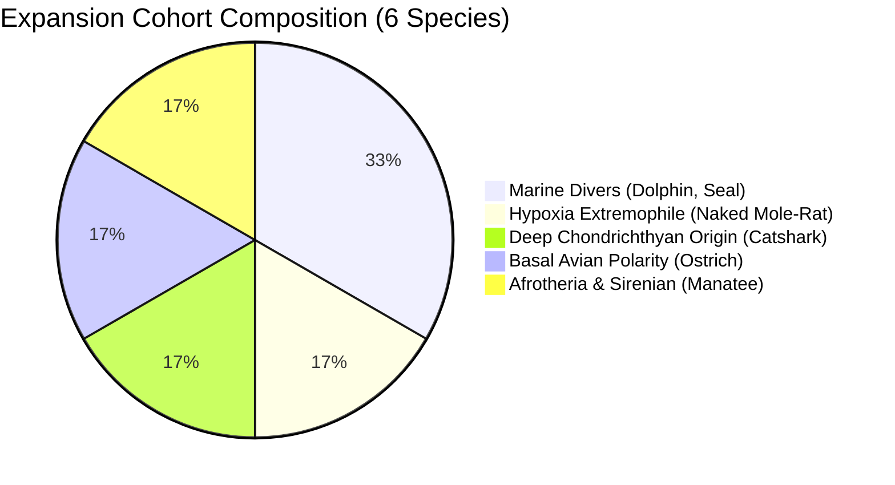
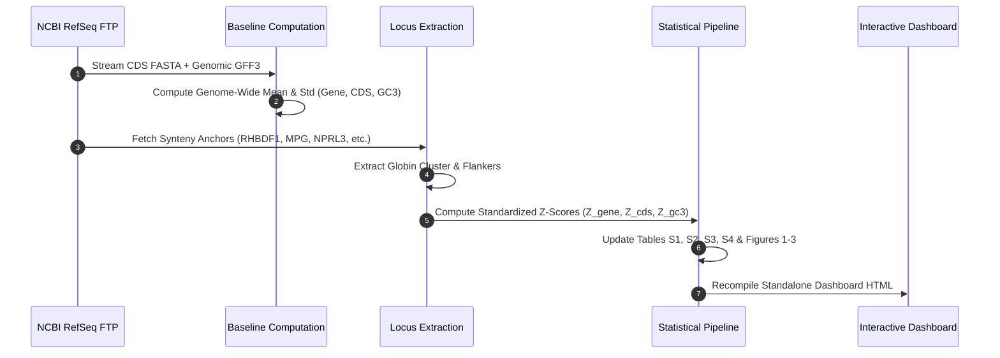

# Chapter 6: Strategic Species Expansion & Macroevolutionary Phenomena

## 1. Executive Summary & Scientific Motivation

The initial 44-vertebrate dataset established foundational macroevolutionary insights into globin locus composition:
1. **Intra-Genomic Divergence (Subunit Polarity $\Delta Z = \alpha - \beta$)**: Mammals display canonical, strong $\alpha \gg \beta$ divergence ($\Delta Z = +2.39\sigma, p = 1.28 \times 10^{-7}$), driven by the insertion of the ancestral therian $\alpha$-globin locus into a hyper-recombining subtelomeric domain. In contrast, birds display an inverted trend ($\beta > \alpha, \Delta Z = -0.22\sigma, p = 0.0549$), and non-avian sauropsids (squamates and testudines) exhibit dual-locus elevation ($Z > +2.5\sigma$).
2. **Isochore Coupling ($R^2 = 0.61, p = 1.21 \times 10^{-18}$)**: Over 61% of globin base composition variance is dictated strictly by the broad chromosomal domain (flanking non-globin orthologs), refuting purely gene-specific adaptation models.
3. **Telomeric Proximity Gradient ($p = 2.26 \times 10^{-7}$)**: Subtelomeric loci ($<5\%$ arm length) exhibit massive GC-biased gene conversion (gBGC) relative to interstitial loci ($Z = +2.10\sigma$ vs $+0.31\sigma$).

To take this framework to the next level, new species additions must be anchored around **specific biological phenomena and evolutionary transition points** that challenge, test, or extend these principles.

---

## 2. Six Primary Biological Phenomena

### Phenomenon 1: Convergent Marine Adaptation ("Mammals of the Sea")
Mammals returned to the sea in three distinct, independent evolutionary radiations:
- **Cetartiodactyla**: Cetaceans (whales, dolphins)
- **Carnivora**: Pinnipeds (seals, sea lions, walruses)
- **Afrotheria**: Sirenians (manatees, dugongs)

#### Physiological & Genomic Characteristics:
1. **Myoglobin (*MB*) Charge & Concentration**: Diving mammals maintain up to 30-fold higher myoglobin concentrations in cardiac and skeletal muscle than terrestrial counterparts. Work by Berenbrink, Campbell, and colleagues established that this is mediated by a massive increase in positive surface electrical charge ($Z_{\text{MB}}$), which generates electrostatic repulsion preventing aggregation and precipitation at hyper-physiological concentrations.
2. **Karyotypic Stability**: Cetaceans possess notoriously stable, conservative karyotypes ($2n = 44$). Testing whether their $\alpha$- and $\beta$-globin loci maintain the mammalian $\Delta Z \approx +2.4\sigma$ polarity or show altered local syntenic boundaries addresses the interplay between chromosomal conservation and physiological specialization.

---

### Phenomenon 2: Subterranean & High-Altitude Hypoxia Extremophiles
Vertebrates inhabiting high-elevation plateaus or subterranean burrows face severe chronic ambient hypoxia, hypobaria, and hypercapnia ($<5\%\text{ O}_2, >10\%\text{ CO}_2$):
- **High-Altitude Birds & Mammals**: Bar-headed geese (*Anser indicus*), Tibetan antelopes (*Pantholops hodgsonii*), and camelids (*Vicugna pacos*) possess stereotypic amino acid substitutions in $\alpha$- and $\beta$-globin chains (e.g. disrupting the low-affinity T-state interfaces) that confer elevated intrinsic oxygen affinity.
- **Subterranean Fossorial Mammals**: The naked mole-rat (*Heterocephalus glaber*) and blind mole-rat (*Nannospalax galili*) live in underground burrows with extreme acidosis tolerance and elevated hemoglobin-oxygen affinity.
- **Genomic Impact**: High-altitude and subterranean taxa frequently exhibit elevated rates of non-homologous or paralogous gene conversion between duplicated globin copies, directly accelerating GC-biased gene conversion (gBGC).

---

### Phenomenon 3: The Evolutionary Loss of Hemoglobin (Antarctic Icefishes)
The most radical globin phenomenon in vertebrate history occurs in Antarctic icefishes (**Channichthyidae**):
- In the freezing ($-1.9^\circ\text{C}$), oxygen-rich Antarctic waters, adult icefishes possess completely transparent blood devoid of hemoglobin and functional erythrocytes.
- Oxygen is transported solely as a dissolved solute in blood plasma, supported by large blood volumes, low viscosity, and immense cardiac outputs.
- In genomic synteny, species like *Chaenocephalus aceratus* exhibit the **scarred deletion of the globin cassette**: the flanking anchor genes (*RHBDF1*, *MPG*, *NPRL3*) remain in place, but the internal $\alpha/\beta$ globin genes have undergone catastrophic pseudogenization and deletion.

---

### Phenomenon 4: The Chondrichthyan Origin of Heterotetrameric Hemoglobin
In our existing dataset, there is a **450-million-year phylogenetic void** between jawless cyclostomes (hagfish and lampreys, which possess monomeric proto-globins) and osteichthyans (spotted gar and teleosts):
- Jawed vertebrates (Gnathostomata) invented the cooperative, heterotetrameric $\alpha_2\beta_2$ hemoglobin system.
- Cartilaginous fishes (Chondrichthyes: sharks, skates, and chimaeras) represent the immediate sister lineage to all bony vertebrates.
- Testing a chondrichthyan genome resolves the primordial gnathostome condition: were $\alpha$ and $\beta$ genes already split onto distinct chromosomes, or were they arranged in a linked cluster, and did their ancestral isochore context already exhibit GC polarity?

---

### Phenomenon 5: The Avian Polarity Inversion & Basal Palaeognathae
In the current dataset, all 6 avian species are Neognathae (chicken, quail, turkey, duck, goose, eagle, starling). All 6 show a consistent **polarity inversion** ($\beta > \alpha$, $\Delta Z \approx -0.22\sigma$), completely reversing the mammalian pattern:
- Is this polarity inversion a universal property of class Aves, or is it an artifact of the hyper-fragmented microchromosomes of modern flying neognaths?
- **Palaeognathae** (the ancient, flightless ratites: ostrich, emu, rhea) possess more ancestral avian karyotypes with distinct chromosomal fusion patterns.
- Analyzing *Struthio camelus* (Common ostrich) provides the critical root to determine whether the inverted polarity originated at the dawn of birds or later in modern neognaths.

---

### Phenomenon 6: The Missing Mammalian Superorder (Afrotheria)
The mammalian tree comprises three major placental superorders:
1. **Laurasiatheria** (Artiodactyls, Carnivorans, Perissodactyls, Bats) — *well-represented (7 species)*
2. **Euarchontoglires** (Primates, Rodents) — *well-represented (3 species)*
3. **Afrotheria** (Elephants, Manatees, Aardvarks, Tenrecs) — ***0 species currently***

Adding an afrotherian (such as the African savanna elephant *Loxodonta africana* or Florida manatee *Trichechus manatus*) bridges this major split, confirming whether the strong $\alpha \gg \beta$ divergence ($+2.4\sigma$) is truly universal across all placental clades.

---

## 3. Master Table of Recommended NCBI RefSeq Candidate Genomes

| Species | Common Name | Clade / Taxonomic Group | NCBI Assembly Accession | Assembly Level | Biological Trait & Significance |
| :--- | :--- | :--- | :--- | :--- | :--- |
| **Tursiops truncatus** | Bottlenose dolphin | Mammalia (Cetacea) | `GCF_011762595.2` (mTurTru1.mat.Y) | Chromosome (VGP) | Cetacean marine diver; stable 2n=44 karyotype |
| **Phoca vitulina** | Harbor seal | Mammalia (Pinnipedia) | `GCF_004314835.1` (mPhoVit1.1) | Chromosome | Independent carnivoran marine dive transition |
| **Heterocephalus glaber** | Naked mole-rat | Mammalia (Rodentia) | `GCF_000247695.1` (HetGla_female_1.0) | Chromosome | Subterranean extreme hypoxia & acidosis model |
| **Scyliorhinus canicula** | Small-spotted catshark | Chondrichthyes (Elasmobranchii) | `GCF_902713615.1` (sScyCan1.1) | Chromosome | Jawed vertebrate origin of $\alpha_2\beta_2$ heterotetramer |
| **Struthio camelus** | Common ostrich | Aves (Palaeognathae) | `GCF_000698965.1` (ASM69896v1) | Chromosome | Basal flightless bird; tests avian polarity inversion root |
| **Trichechus manatus** | Florida manatee | Mammalia (Afrotheria / Sirenia) | `GCF_000243295.1` (TriManLat1.0) | Scaffold/Chrom | Dual role: Afrotherian superorder + marine sirenian diver |
| **Chaenocephalus aceratus** | Blackfin icefish | Teleostei (Channichthyidae) | `GCF_003792605.1` (ChaAce1.0) | Chromosome | The only vertebrates with complete hemoglobin gene loss |
| **Loxodonta africana** | African savanna elephant | Mammalia (Afrotheria) | `GCF_018395345.1` (mLoxAfr4) | Chromosome (VGP) | Canonical terrestrial Afrotherian outgroup |
| **Latimeria chalumnae** | Coelacanth | Sarcopterygii (Actinistia) | `GCF_000225785.1` (LatCha1) | Chromosome | Sarcopterygian outgroup to tetrapods |
| **Anser indicus** | Bar-headed goose | Aves (Anatidae) | `GCF_009769405.1` (AnsInd1.0) | Scaffold | High-altitude hypoxia adaptation model |

---

## 4. Selected 6-Species Expansion Cohort

For immediate pipeline integration, the following 6 species provide balanced representation across all target phenomena:

1. **`tursiops_truncatus` (Bottlenose dolphin)** — Marine diver (Cetacea)
2. **`phoca_vitulina` (Harbor seal)** — Marine diver (Pinnipedia)
3. **`heterocephalus_glaber` (Naked mole-rat)** — Subterranean hypoxia/hypercapnia
4. **`scyliorhinus_canicula` (Small-spotted catshark)** — Chondrichthyes (bridges 450-Myr gap)
5. **`struthio_camelus` (Common ostrich)** — Palaeognathae (roots avian polarity inversion)
6. **`trichechus_manatus` (Florida manatee)** — Afrotheria + Sirenian shallow marine diver

---

## 5. Pipeline Execution Plan

The standard processing pipeline executes the following stages for each taxon:

1. **FTP Resource Retrieval**: Stream official NCBI RefSeq `cds_from_genomic.fna.gz` and `genomic.gff.gz`.
2. **Empirical Baseline Calculation**: Compute genome-wide $\mu$ and $\sigma$ for whole-gene GC, CDS GC, and third codon positions (GC3).
3. **Locus Annotation & Z-Standardization**: Calculate $Z$-scores across globin paralogs and flanking non-globin control genes.
4. **Statistical Table Synchronization**: Update Supplementary Tables S1 (Species Baselines), S2 (Globin Loci Summary), S3 (All Genes Database), and S4 (Hypothesis Tests).
5. **Dashboard Compilation**: Regenerate `results/dashboard.html` with expanded species options and updated macroevolutionary figures.

---

## 6. Serpentes Radiation: Subunit Polarity Inversion & Extreme Subtelomeric GC Elevation

With the addition of 4 strategic snake genomes, the atlas now covers the full breadth of the snake radiation (5 species across 4 major families: Boidae/Candoiidae, Viperidae, Elapidae, and Colubridae):
1. **`candoia_aspera` (New Guinea Ground Boa, Boidae/Candoiidae)** — Basal constrictor (Henophidia)
2. **`vipera_berus` (Common European Adder, Viperidae)** — Solenoglyphous venomous viper
3. **`notechis_scutatus` (Mainland Tiger Snake, Elapidae)** — Proteroglyphous neurotoxic elapid
4. **`pantherophis_guttatus` (Corn Snake, Colubridae)** — Premier squamate genetics model
5. **`thamnophis_elegans` (Western Garter Snake, Colubridae: Natricinae)** — Semi-aquatic colubrid

### Key Comparative Findings:
- **Universal Subunit Polarity Inversion ($\beta > \alpha$)**: While mammals maintain canonical $\alpha \gg \beta$ divergence ($\Delta Z \approx +2.39\sigma$), all five snakes exhibit profound inverted polarity ($\Delta Z = -1.08\sigma$ to $-2.31\sigma$).
- **Evolutionary Escalation from Henophidia to Caenophidia**:
  - In the basal boa (*Candoia aspera*), the $\beta$-locus whole-gene Z-score is $+3.25\sigma$ ($\Delta Z = -1.08\sigma$).
  - In advanced caenophidian snakes, the $\beta$-locus reaches extraordinary GC elevation: Viperidae (*Vipera berus*, $+3.80\sigma, \Delta Z = -2.00\sigma$), Elapidae (*Notechis scutatus*, $+4.09\sigma, \Delta Z = -1.89\sigma$), and Colubridae (*Pantherophis guttatus*, $+4.20\sigma, \Delta Z = -2.31\sigma$; *Thamnophis elegans*, $+3.93\sigma, \Delta Z = -1.85\sigma$).
- **Mechanistic Driver (Terminal Subtelomeric Insertion)**: Both $\alpha$ and $\beta$ loci in all snakes are localized within $<0.01$ (the terminal 1%) of the chromosome arm, embedded in dense olfactory receptor clusters and flanked by $RRM1$/$STIM1$ ($\beta$) and $RHBDF1$/$MPG$/$NPRL3$ ($\alpha$), subjecting the $\beta$-globin cluster to the most extreme continuous GC-biased gene conversion (gBGC) observed among non-avian vertebrates.

