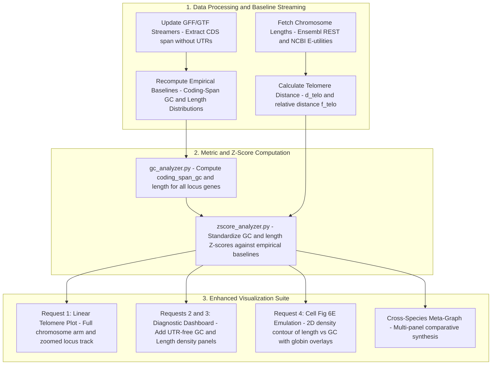

# Comprehensive Implementation Plan: Linear Telomere Tracks, UTR-Free Gene GC, Gene Length Distributions, and Cell Fig. 6E Bivariate Plots

This document outlines the architectural specifications, mathematical definitions, data processing workflows, and visualization designs to implement the user's four requests and integrate the approved candidate species into the vertebrate globin comparative pipeline.

---

## 1. Executive Overview of Requirements



---

## 2. Request 1: Linear Chromosome Arm Graph & Telomere Proximity

### Biological Objective
To visually determine whether high GC content and rapid compositional divergence are physically linked to subtelomeric locations or microchromosomal contexts (e.g. *Pogona vitticeps* microchromosome 13 vs. human chromosome 16p vs. chicken chromosome 25).

### Mathematical Definition
For any locus on a chromosome of total length $L_{\text{chr}}$ with start coordinate $S$ and end coordinate $E$:
* **Distance to Nearest Telomere**:
  $$d_{\text{telo}} = \min(S, L_{\text{chr}} - E)$$
* **Relative Chromosomal Distance (Normalized)**:
  $$f_{\text{telo}} = \frac{d_{\text{telo}}}{L_{\text{chr}}} \quad (0.0 \le f_{\text{telo}} \le 0.5)$$
  * $f_{\text{telo}} < 0.05$: Extreme subtelomeric ($< 5\%$ from chromosome tip, high recombination).
  * $0.05 \le f_{\text{telo}} < 0.20$: Subtelomeric / arm-peripheral.
  * $f_{\text{telo}} \ge 0.20$: Interstitial / pericentromeric.

### Visualization Design (`plot_chromosome_linear`)
1. **Macro/Microchromosome Overview Bar**:
   * A full horizontal idiogram representing the complete chromosome from $0$ to $L_{\text{chr}}$ (in Mb).
   * A distinctive shaded band highlighting the globin locus window.
   * Clear telomere callout: e.g., `"Distance to 3' Telomere: 110.3 kb (0.005 of Chr 13)"`.
   * Chromosome classification label: Macrochromosome ($> 40\text{ Mb}$), Intermediate ($20\text{–}40\text{ Mb}$), or Microchromosome ($< 20\text{ Mb}$).
2. **Zoomed Locus Architecture Track (Inset / Lower Panel)**:
   * Direct linear genomic track showing the exact gene boundaries, transcriptional orientation (arrows $\rightarrow$ / $\leftarrow$), and color coding:
     * $\alpha$-globins: Carmine Red (`#d32f2f`)
     * $\beta$-globins: Royal Blue (`#1976d2`)
     * Syntenic Flankers (`MPG`, `RHBDF1`, `NPRL3`, `LUC7L2`): Forest Green (`#388e3c`)
     * Other Locus Genes: Muted Grey (`#757575`)
   * Dual output: Publication-quality static vector graphics (PDF/PNG) and interactive Plotly HTML with hoverable gene details.

---

## 3. Request 2: Refining "Gene" Calculations (Strictly Excluding UTRs)

### Biological Rationale
Untranslated regions (5' UTR and 3' UTR) often suffer from heterogeneous or incomplete annotation across non-model vertebrate assemblies (e.g., automated RNA-seq predictions vs. curated RefSeq models). Furthermore, UTRs have distinct selective pressures and nucleotide biases (such as polyadenylation signals and AU-rich elements). Excluding UTRs establishes a clean, consistent **Coding-Span** gene definition across all genomes.

### Precise Definition of "Coding-Span Gene"
For any protein-coding transcript with CDS exon coordinates $\{[c_{i,\text{start}}, c_{i,\text{end}}]\}_{i=1}^N$:
* **Genomic Coding Boundaries**:
  $$S_{\text{coding}} = \min_{1 \le i \le N} c_{i,\text{start}}, \quad E_{\text{coding}} = \max_{1 \le i \le N} c_{i,\text{end}}$$
* **Included Sequence**:
  $$\text{Coding-Span Region} = \text{Genomic DNA}[S_{\text{coding}} : E_{\text{coding}}]$$
  This region strictly encompasses:
  1. All coding exons (CDS).
  2. All intervening internal introns located between coding exons.
  3. **Strictly trims away**: 5' UTR exons, 3' UTR exons, and non-coding flanking regions of terminal exons.
* **Metrics Computed**:
  * `coding_span_gc`: GC% of the genomic span $[S_{\text{coding}}, E_{\text{coding}}]$.
  * `intronic_no_utr_gc`: GC% of internal introns only (splicing out all CDS features).
  * `cds_gc`: GC% of spliced coding exons.
  * `gc3`: GC% at 3rd codon positions.

### Genome-Wide Baseline Recalculation
To calculate valid Z-scores, empirical distributions must be established from the exact same metric across all protein-coding genes in each genome:
1. Update `scripts/compute_all_gene_baselines.py` (Ensembl) and `scripts/compute_ncbi_whole_gene_baselines.py` (NCBI RefSeq) to extract $[S_{\text{coding}}, E_{\text{coding}}]$ from GFF/GTF `CDS` features.
2. Compute `coding_span_gc` for every protein-coding gene.
3. Calculate empirical parameters:
   $$\mu_{\text{coding\_span\_gc}}, \quad \sigma_{\text{coding\_span\_gc}}, \quad \text{Median}, \quad Q_{25}, \quad Q_{75}$$
4. Re-calculate standardized gene Z-scores:
   $$Z_{\text{coding\_span\_gc}} = \frac{\text{coding\_span\_gc} - \mu_{\text{coding\_span\_gc}}}{\sigma_{\text{coding\_span\_gc}}}$$

---

## 4. Request 3: Gene Length Metric & Empirical Distribution Panels

### Definition of Gene Length
Using the UTR-free coding span defined above:
* **Coding-Span Length ($L_{\text{gene}}$)**:
  $$L_{\text{gene}} = E_{\text{coding}} - S_{\text{coding}} + 1 \quad (\text{in base pairs})$$
* **Log-Transformed Length**:
  $$\ell = \log_{10}(L_{\text{gene}})$$
  Because eukaryotic gene lengths are log-normally distributed, log-transformation is statistically obligatory for Gaussian baseline modeling.
* **Standardized Gene Length Z-Score**:
  $$Z_{\text{length}} = \frac{\ell - \mu_{\log_{10}(L)}}{\sigma_{\log_{10}(L)}}$$

### Diagnostic Distribution Panel
In both the static (`plot_diagnostic`) and interactive (`plot_diagnostic_interactive`) dashboards:
* Add a dedicated **Gene Length Empirical Distribution Panel**:
  * X-axis: $\log_{10}(\text{Gene Length [bp]})$ with linear scale tick annotations ($100\text{ bp}$, $1\text{ kb}$, $10\text{ kb}$, $100\text{ kb}$, $1\text{ Mb}$).
  * Background: Smooth kernel density estimate (KDE) and histogram of all protein-coding genes in that species' genome.
  * Foreground: Vertical dashed lines and marker pins indicating where each analyzed globin and non-globin gene sits relative to the genome-wide median.

---

## 5. Request 4: Emulating Cell Figure 6E ($\log_{10}(\text{Length})$ vs. GC Content)

### Reference Literature Context
In Małszycki, Aktaş et al., *Cell* 2026 (*Nuclear speckles enable processing of RNA from GC-rich isochores*, PMID: 41747727, PMCID: PMC13283296), Figure 6E (and Figure S6B, F) revealed an amniote-specific evolutionary pattern:
* Amniote genomes feature an arc extending toward the top-left quadrant: **short genomic lengths combined with extreme GC content**.
* In fish and invertebrates, this top-left arc is absent or attenuated.

### Plot Architecture (`plot_length_vs_gc_bivariate`)
* **X-axis**: $\log_{10}(\text{Coding-Span Gene Length [bp]})$ spanning from $1.5$ ($30\text{ bp}$) to $6.5$ ($3\text{ Mb}$).
* **Y-axis**: Coding-Span GC Content (%) spanning from $15\%$ to $90\%$.
* **Background Distribution**:
  * 2D Kernel Density Estimate (KDE) contour lines and semi-transparent heat shading representing the full population of all protein-coding genes in the genome.
  * Marginal distributions (KDE curves) on the top (length) and right (GC) axes.
* **Overlay**:
  * Analyzed genes plotted as prominent symbols:
    * $\alpha$-globins: Filled red circles
    * $\beta$-globins: Filled blue squares
    * Syntenic non-globin flankers: Filled green triangles
    * Non-syntenic / other locus genes: Grey diamonds
  * Hover tooltip (Plotly): Gene symbol, length in bp, GC%, Z-scores ($Z_{\text{GC}}$ and $Z_{\text{length}}$), and chromosomal coordinates.

```
       Coding-Span GC (%)
        ^
    90% |             [ Amniote Arc: Short & Hyper-GC ]
        |                 * α-globins (*Pogona*, Anole, Human)
        |               *   *
        |             *       *
    50% |       +------------------------------------+
        |       |   Genome-Wide Background Density   |
        |       |          (2D Contour Cloud)        |
        |       +------------------------------------+
    20% |
        +-------------------------------------------------->
           10^2 bp          10^3 bp         10^4 bp         10^5 bp
                                 log10(Gene Length [bp])
```

---

## 6. Pipeline Expansion: Integrating 6 Approved Species

We will add the 6 priority chromosome-level RefSeq assemblies into the pipeline:

| Species | Common Name | Clade | Assembly Accession | Chromosomes & Loci |
| :--- | :--- | :--- | :--- | :--- |
| **Podarcis muralis** | Common Wall Lizard | Squamata (Lacertidae) | `GCF_964188315.1` | $\alpha$ on Chr 14 (54.8 Mb); $\beta$ on Chr 4 (1.5 Mb) |
| **Thamnophis elegans** | Western Garter Snake | Squamata (Serpentes) | `GCF_009769535.1` | $\alpha$ on Chr 14 (103 kb); $\beta$ on Chr 6 (390 kb) |
| **Chelonia mydas** | Green Sea Turtle | Testudines (Cheloniidae) | `GCF_015237465.2` | $\alpha$ on Chr 10 (31.3 Mb); $\beta$ on Chr 1 (3.6 Mb) |
| **Pelodiscus sinensis** | Chinese Softshell Turtle | Testudines (Trionychidae) | `GCF_049634645.1` | $\alpha$ on Chr 16 (4.6 Mb); $\beta$ on Chr 1 (331 Mb) |
| **Gasterosteus aculeatus** | Three-Spined Stickleback | Teleostei (Percomorpha) | `GCF_964276395.1` | Linked $\alpha$/$\beta$ on Chr 11 (15.2 Mb); $\alpha$ on Chr 5 |
| **Carassius auratus** | Goldfish | Teleostei (Cypriniformes) | `GCF_003368295.1` | Duplicated loci on Chr 5 (24.5 Mb) and Chr 12 (9.3 Mb) |

---

## 7. Concrete Implementation Steps

1. **Step 1: Baseline Architecture Update (`scripts/compute_all_gene_baselines.py`, `scripts/compute_ncbi_whole_gene_baselines.py`)**:
   * Add extraction of coding span $[S_{\text{coding}}, E_{\text{coding}}]$ from CDS entries.
   * Calculate `coding_span_gc`, `coding_span_len`, and $\log_{10}(\text{len})$.
   * Update baseline caches for all species.
2. **Step 2: Locus & Gene Analysis (`globin_pipeline/gc_analyzer.py`)**:
   * Refine gene GC to calculate `coding_span_gc` (excluding UTRs) and `coding_span_len`.
   * Keep `full_gene_gc` (with UTRs) for transparent backwards-compatibility.
3. **Step 3: Z-Score & Statistical Engine (`globin_pipeline/zscore_analyzer.py`)**:
   * Standardize both $Z_{\text{coding\_span\_gc}}$ and $Z_{\text{length}}$.
4. **Step 4: Linear Telomere Visualizer (`globin_pipeline/visualizer.py`)**:
   * Implement `plot_chromosome_linear()`: full chromosome arm with telomere distance and zoomed locus gene track.
5. **Step 5: Diagnostic Dashboard Redesign (`globin_pipeline/visualizer.py`)**:
   * Integrate the new Gene Length distribution panel and the Cell Figure 6E 2D bivariate contour plot into both static PNG/PDF and interactive Plotly HTML dashboards.
6. **Step 6: Execution & Verification**:
   * Run the expanded pipeline across the full cohort (now 26 species).
   * Synchronize all results to `1_data_from_mike/results/` and documentation to `1_data_from_mike/docs/`.
